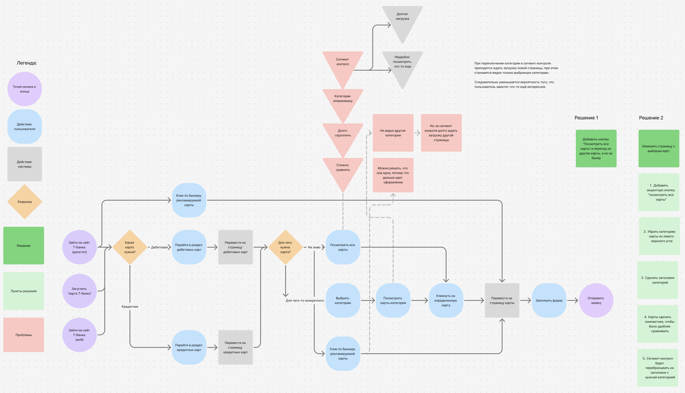

# Путь пользователя: оформление карты на сайте (user flow и гипотезы роста конверсии)

## Задача
Увеличить число оформленных карт через сайт (десктоп и мобильная версия), не ухудшив удобство для существующих пользователей.

Разбор сделан на основе публичной части сайта Т-Банка.

## Что сделала
- Нарисовала **AS IS user flow**: от входа на сайт (десктоп/моб) до отправки заявки, с развилками «дебетовая или кредитная карта» и «для чего нужна карта».
- Отметила **проблемные места пути**: после переключения категории нужно ждать загрузку новой страницы, видна только выбранная категория; категории идут вперемешку; долго скроллить; сложно сравнивать карты. Из-за этого пользователь может не заметить другие карты или решить, что карта одна.
- Предложила **два решения** для страницы выбора карт и сформулировала **4 гипотезы** роста конверсии в формате «если — то — потому что» с метриками.

## Схема (AS IS)

## Гипотезы и метрики

| № | Если | То вырастет | Потому что |
|---|---|---|---|
| 1 | На странице выбора добавить акцентную кнопку «Посмотреть все карты» и заголовки категорий, сделать карточки компактнее, а при переключении сегмента прокручивать к категории, а не открывать новую страницу | Конверсия из каталога в оформление карты, CTR (клик «оформить карту» / просмотры) | Проще ориентироваться и сравнивать карты, не нужно ждать загрузку страницы |
| 2 | Кнопка «Посмотреть все карты» будет вести в каталог, а не на баннер перед блоком оформления | Конверсия из страницы выбора в просмотр других карт, CTR | Проще дойти до полного списка, нет отвлечения на промо и мысли «других карт нет» |
| 3 | На этапе авторизации давать код подтверждения по e-mail или в мессенджере вместо SMS | Конверсия успешного подтверждения | Часть пользователей не получает SMS (роуминг, блокировки) и отваливается на этом шаге |
| 4 | Сократить число шагов подачи заявки (как в премиум-оформлении) | Конверсия из начала анкеты в отправку заявки; доля брошенных анкет снизится | Быстрее и проще пройти оформление, меньше мест, где устать или ошибиться |

## Как проверять
A/B-тесты: контрольная группа видит текущую версию, тестовая — изменённую. Основные метрики: конверсия по шагам воронки и CTR на оформление карты.

## Что не сделано
Гипотезы основаны на разборе пути пользователя, без продуктовых данных. A/B-тесты не проводились, эффект не измерялся.

## Инструменты
Разбор user flow, продуктовые метрики (CR, CTR), формулирование гипотез, план A/B-тестов.
